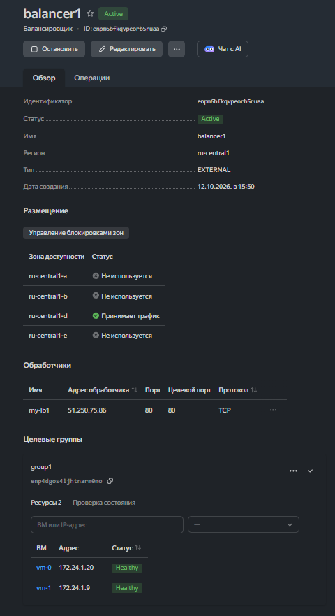
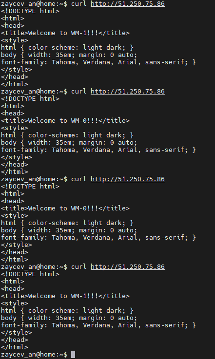
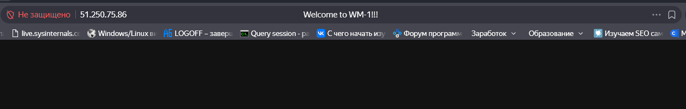
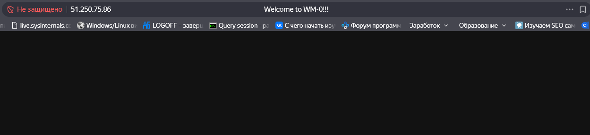

# Домашнее задание к занятию "Отказоустойчивость в облаке" - `Зайцев Алексей`

---

## Задание 1

> Возьмите за основу [решение к заданию 1 из занятия «Подъём инфраструктуры в Яндекс Облаке»](https://github.com/netology-code/sdvps-homeworks/blob/main/7-03.md#задание-1).

> Теперь вместо одной виртуальной машины сделайте terraform playbook, который:  

> создаст 2 идентичные виртуальные машины. Используйте аргумент [count](https://www.terraform.io/docs/language/meta-arguments/count.html) для создания таких ресурсов;  
создаст [таргет-группу](https://registry.terraform.io/providers/yandex-cloud/yandex/latest/docs/resources/lb_target_group). Поместите в неё созданные на шаге 1 виртуальные машины;  
создаст [сетевой балансировщик нагрузки](https://registry.terraform.io/providers/yandex-cloud/yandex/latest/docs/resources/lb_network_load_balancer), который слушает на порту 80, отправляет трафик на порт 80 виртуальных машин и http healthcheck на порт 80 виртуальных машин. 
Рекомендуем изучить [документацию сетевого балансировщика нагрузки](https://cloud.yandex.ru/docs/network-load-balancer/quickstart) для того, чтобы было понятно, что вы сделали.

> Установите на созданные виртуальные машины пакет Nginx любым удобным способом и запустите Nginx веб-сервер на порту 80.

> Перейдите в веб-консоль Yandex Cloud и убедитесь, что:  
созданный балансировщик находится в статусе Active,  
обе виртуальные машины в целевой группе находятся в состоянии healthy.

> Сделайте запрос на 80 порт на внешний IP-адрес балансировщика и убедитесь, что вы получаете ответ в виде дефолтной страницы Nginx.  
*В качестве результата пришлите:* 
*1. Terraform Playbook.* 
*2. Скриншот статуса балансировщика и целевой группы.* 
*3. Скриншот страницы, которая открылась при запросе IP-адреса балансировщика.* 

1. Плэйбук терраформа: 
[main.tf](./main.tf) 
   Плэйбук установки Nginx: 
[playbook.yml](./ansible-nginx/playbook.yml) 

2. Балансировщик
   

   Curl запросы  
   

3. Первый запрос по WEB
   

   Второй запрос по WEB
    

---

